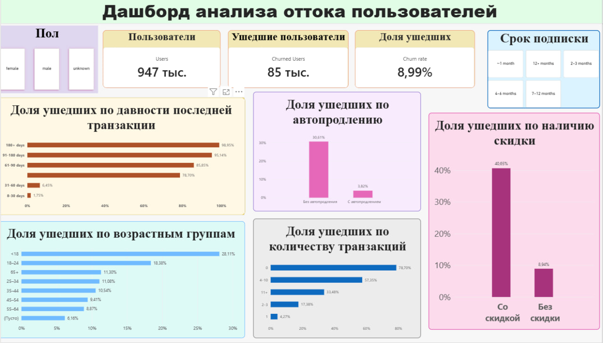

# Customer Churn Analysis

Проект по анализу оттока пользователей с использованием Python, SQL и Power BI.

Цель проекта — определить основные факторы, связанные с уходом пользователей, и визуализировать результаты в интерактивном дашборде.

## Dashboard

## Инструменты

- Python
- pandas
- SQL
- ClickHouse
- Power BI
- DAX

## Что было сделано

- Проведена очистка и подготовка данных в Python
- Выполнен исследовательский анализ пользовательского поведения
- Рассчитан общий уровень оттока
- Проведён анализ оттока по:
  - давности последней транзакции
  - автопродлению
  - возрастным группам
  - количеству транзакций
  - наличию скидки
- Написаны SQL-запросы с использованием:
  - GROUP BY
  - CASE
  - CTE
  - оконной функции RANK()
- Создан Power BI дашборд с KPI, графиками и фильтрами

## Основные результаты

- Общий уровень оттока — **8,99%**
- Чем больше времени прошло с последней транзакции, тем выше вероятность ухода
- Пользователи с автопродлением имеют значительно более низкий churn
- Пользователи со скидкой показывают более высокий уровень оттока
- Молодые пользователи уходят чаще
- Связь между количеством транзакций и churn оказалась нелинейной

## Файлы проекта

- `customer_retention_analysis.ipynb` — анализ данных в Python
- `churn_analysis.sql` — SQL-анализ
- `dashboard_churn.pbix` — Power BI дашборд
- `dashboard_analysis.jpg` — изображение финального дашборда
